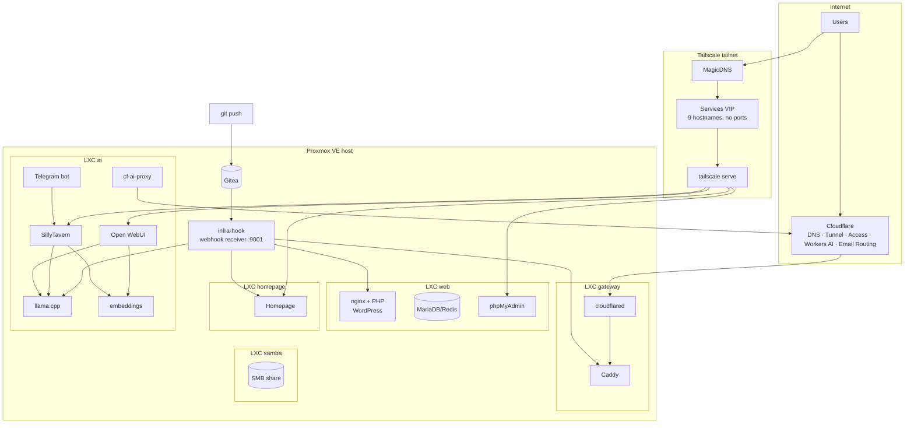

# homelab-infra

一套小型自托管家庭实验室的**基础设施即代码**：Proxmox 容器、Docker 服务、Tailscale 组网、Cloudflare 边缘，以及 Git 驱动的部署链路。

> 这是我私有基础设施仓库的**脱敏公开版**。主机名、IP、token、密码都已替换为占位符，但结构与运维逻辑是真实的。

## 这是什么

一台运行 Proxmox VE 的服务器，拆成若干 LXC 容器：

| LXC | 角色 | 主要服务 |
|---|---|---|
| gateway | 公网入口 + 反向代理 | Caddy、cloudflared、Portainer |
| web | 网站与 Git | nginx + PHP-FPM（WordPress）、MariaDB、Redis、phpMyAdmin、Gitea、Portainer |
| homepage | 面板 | Homepage、Portainer |
| ai | 推理与工具 | llama.cpp、embedding、Open WebUI、SillyTavern、SearXNG、Workers AI 代理、Telegram bot、Portainer |
| samba | 存储 | 大容量 HDD 上的 SMB 共享 |

合计约 19 个容器，全部由本仓库中的 compose 文件或简单构建上下文定义。

## 目录结构

```
caddy/        公网入口路由（按 Host 分流）
homepage/     面板配置（服务、小组件）
lemp/         WordPress 栈（compose、PHP Dockerfile、nginx 配置）
gitea/        自建 Git
ai-stack/     推理与工具 compose、Telegram bot、Workers AI 代理
infra-hook/   部署接收器：webhook 处理 + 各服务的部署脚本
```

## 部署是怎么工作的

```
git push
  → Gitea webhook
  → infra-hook（宿主机 systemd，:9001，带密钥路径）
  → 服务器端 clone 内 git pull
  → 只把变更的配置推进对应 LXC（pct push）
  → 按需热重载 / 重启
```

静态站（Astro）在一次性 `node:20-alpine` 容器里构建，产物直接复制到 Web 根目录。另有一条链路服务 GitHub 上的仓库：GitHub Actions 的自托管 Runner 打包源码后 POST 到同一个接收器。

## 快速开始

1. 复制 `.env.example` → `.env`，填入真实值。
2. 替换占位符：IP（`10.0.0.x`）、域名（`example.com` / `example.ts.net`）、容器 ID。
3. 按需启动：

```bash
cd lemp && docker compose up -d
cd ../gitea && docker compose up -d
cd ../ai-stack && docker compose up -d
```

4. 在宿主机安装部署接收器（详见 `infra-hook/`）。

## 设计原则

- **一切进 Git**：compose、代理配置、部署脚本、面板配置。
- **最小公网暴露**：只有两个网站和一个 webhook 路径能从公网访问，其余全在 tailnet 内。
- **不记端口**：服务通过 Tailscale MagicDNS / Services 以域名访问。
- **共享 embedding 服务**：多个 AI 前端复用同一个向量服务，避免重复建索引。
- **密钥不进 Git**：仓库里只有占位符，真实值放在 `.env` 或宿主机文件中。

## 安全说明

- 本仓库**不含**任何凭据、token、内网主机名或地址。
- `.env` 已被 git 忽略。
- 公网入口在 Cloudflare Tunnel 之后；管理界面由 Cloudflare Access 保护。

## 许可

MIT

---

# homelab-infra (English)
Infrastructure-as-code for a small self-hosted homelab: Proxmox containers, Docker services, Tailscale networking, Cloudflare edge, and Git-driven deployment.

> This is a **sanitized public copy** of my private infrastructure repository.
> Hostnames, IPs, tokens and passwords are replaced with placeholders — the structure and the operational logic are real.

## What this is

A single server running Proxmox VE, split into a handful of LXC containers:

| LXC | Role | Main services |
|---|---|---|
| gateway | public entry + reverse proxy | Caddy, cloudflared, Portainer |
| web | websites and git | nginx + PHP-FPM (WordPress), MariaDB, Redis, phpMyAdmin, Gitea, Portainer |
| homepage | dashboard | Homepage, Portainer |
| ai | inference and tools | llama.cpp server, embeddings, Open WebUI, SillyTavern, SearXNG, Workers AI proxy, Telegram bot, Portainer |
| samba | storage | SMB share on a large HDD |

Around 19 containers in total, all defined as compose files or simple build contexts in this repo.

## Architecture



More detail: [`docs/architecture.md`](docs/architecture.md).

## Repository layout

```
caddy/        Caddyfile (public entry, host-based routing)
homepage/     dashboard configuration (services, widgets)
lemp/         WordPress stack (compose, PHP Dockerfile, nginx conf)
gitea/        self-hosted git
ai-stack/     compose for inference + tools, Telegram bot, Workers AI proxy
infra-hook/   deployment receiver: webhook handler + deploy scripts
```

## How deployment works

```
git push
  → Gitea webhook
  → infra-hook (systemd, :9001, secret path)
  → git pull in a server-side clone
  → push the changed configs into the right LXC (pct push)
  → reload / restart only what changed
```

Static site builds (Astro) run in a throwaway `node:20-alpine` container and the output is copied to the web root. A second path exists for GitHub-hosted repos: GitHub Actions on a self-hosted runner packages the source and POSTs it to the same receiver.

See [`infra-hook/`](infra-hook/) and [`docs/decisions.md`](docs/decisions.md).

## Quick start (adapt to your environment)

1. Copy `.env.example` → `.env` and fill in real values.
2. Replace placeholder IPs (`10.0.0.x`), hostname (`example.com`, `example.ts.net`) and container IDs with yours.
3. Bring up the stacks you need, e.g.:

```bash
cd lemp && docker compose up -d
cd ../gitea && docker compose up -d
cd ../ai-stack && docker compose up -d
```

4. Install the deployment receiver on the host:

```bash
install -m 755 infra-hook/deploy.sh infra-hook/deploy-astro.sh infra-hook/deploy-wp.sh infra-hook/deploy-github.sh /opt/infra-hook/
# replace the placeholder secret in receiver.py, then run it as a systemd service on :9001
```

## Design principles

- **Everything in git** — compose files, proxy config, deploy scripts, dashboard config.
- **Minimal public surface** — only the websites and one webhook path are reachable from the internet; everything else lives in the tailnet.
- **No ports to remember** — services are addressed by name through Tailscale MagicDNS / Services.
- **One shared embedding model** — multiple AI frontends reuse the same vector service instead of re-indexing.
- **Secrets never in git** — placeholders only; real values live in `.env` / host files.

## Security notes

- This repo intentionally contains **no** credentials, tokens, internal hostnames or addresses.
- `.env` is git-ignored.
- The public entry is behind Cloudflare Tunnel; admin surfaces are protected by Cloudflare Access.

## License

MIT — see [LICENSE](LICENSE).
