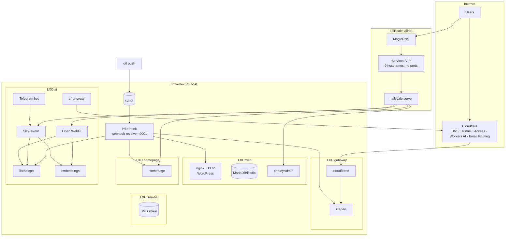

# homelab-infra

Infrastructure-as-code for a small self-hosted homelab: Proxmox containers, Docker services, Tailscale networking, Cloudflare edge, and Git-driven deployment.

> This is a **sanitized public copy** of my private infrastructure repository.
> Hostnames, IPs, tokens and passwords are replaced with placeholders — the structure and the operational logic are real.

## What this is

A single server running Proxmox VE, split into a handful of LXC containers:

| LXC | Role | Main services |
|---|---|---|
| gateway | public entry + reverse proxy | Caddy, cloudflared, Portainer |
| web | websites and git | nginx + PHP-FPM (WordPress), MariaDB, Redis, phpMyAdmin, Gitea, Portainer |
| homepage | dashboard | Homepage, Portainer |
| ai | inference and tools | llama.cpp server, embeddings, Open WebUI, SillyTavern, SearXNG, Workers AI proxy, Telegram bot, Portainer |
| samba | storage | SMB share on a large HDD |

Around 19 containers in total, all defined as compose files or simple build contexts in this repo.

## Architecture



More detail: [`docs/architecture.md`](docs/architecture.md).

## Repository layout

```
caddy/        Caddyfile (public entry, host-based routing)
homepage/     dashboard configuration (services, widgets)
lemp/         WordPress stack (compose, PHP Dockerfile, nginx conf)
gitea/        self-hosted git
ai-stack/     compose for inference + tools, Telegram bot, Workers AI proxy
infra-hook/   deployment receiver: webhook handler + deploy scripts
```

## How deployment works

```
git push
  → Gitea webhook
  → infra-hook (systemd, :9001, secret path)
  → git pull in a server-side clone
  → push the changed configs into the right LXC (pct push)
  → reload / restart only what changed
```

Static site builds (Astro) run in a throwaway `node:20-alpine` container and the output is copied to the web root. A second path exists for GitHub-hosted repos: GitHub Actions on a self-hosted runner packages the source and POSTs it to the same receiver.

See [`infra-hook/`](infra-hook/) and [`docs/decisions.md`](docs/decisions.md).

## Quick start (adapt to your environment)

1. Copy `.env.example` → `.env` and fill in real values.
2. Replace placeholder IPs (`10.0.0.x`), hostname (`example.com`, `example.ts.net`) and container IDs with yours.
3. Bring up the stacks you need, e.g.:

```bash
cd lemp && docker compose up -d
cd ../gitea && docker compose up -d
cd ../ai-stack && docker compose up -d
```

4. Install the deployment receiver on the host:

```bash
install -m 755 infra-hook/deploy.sh infra-hook/deploy-astro.sh infra-hook/deploy-wp.sh infra-hook/deploy-github.sh /opt/infra-hook/
# replace the placeholder secret in receiver.py, then run it as a systemd service on :9001
```

## Design principles

- **Everything in git** — compose files, proxy config, deploy scripts, dashboard config.
- **Minimal public surface** — only the websites and one webhook path are reachable from the internet; everything else lives in the tailnet.
- **No ports to remember** — services are addressed by name through Tailscale MagicDNS / Services.
- **One shared embedding model** — multiple AI frontends reuse the same vector service instead of re-indexing.
- **Secrets never in git** — placeholders only; real values live in `.env` / host files.

## Security notes

- This repo intentionally contains **no** credentials, tokens, internal hostnames or addresses.
- `.env` is git-ignored.
- The public entry is behind Cloudflare Tunnel; admin surfaces are protected by Cloudflare Access.

## License

MIT — see [LICENSE](LICENSE).
